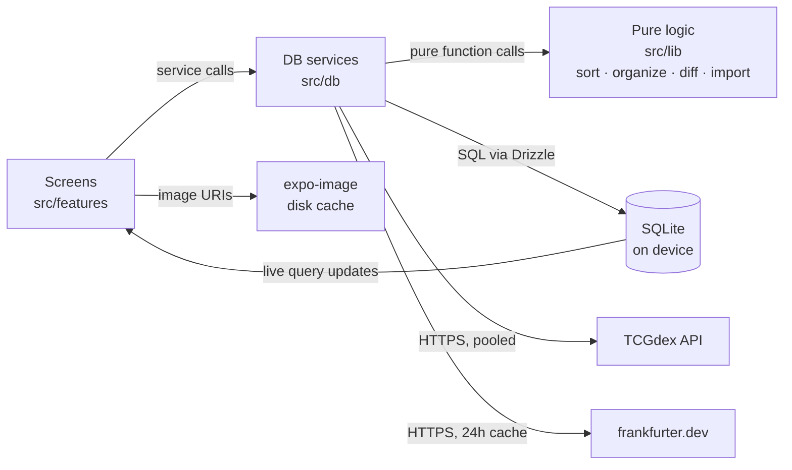

# PokéBinder

An offline-first mobile app for Pokémon TCG collectors to design digital replicas of their
physical card binders, organize them in one tap, and get a step-by-step move list for
re-sorting the real binder to match.

Built with React Native + Expo, TypeScript (strict), SQLite + Drizzle, Reanimated 4 and Skia.

## Demo

<!-- TODO: add screenshots or a screen recording (binder spread, drag & drop, auto-organize, move list) -->
_Screenshots coming soon._

## Features

- **Binders with real pocket layouts**: 2x2, 3x3, 3x4 or 4x4, with page navigation and a page-turn animation.
- **Drag & drop cards between pockets**: long-press pickup with haptics, tap-to-place fallback, and auto page-flip when you hold a card at the screen edge.
- **Add cards by search or set browser**: card data, images and prices come from [TCGdex](https://tcgdex.dev), cached locally.
- **One-tap auto-organize** by master set, colour, Pokédex number, rarity or custom order. A shuffle animation plays while it computes.
- **Physical re-sort move list**: diffs your current binder against the sorted target and outputs instructions you can follow at a real binder ("shift pockets 5–9 right by one", swaps, rings), with checkable steps.
- **Mirror capture**: walk your physical binder pocket by pocket (with skip-slot) to recreate it in the app.
- **Set checklists** with rapid multi-tap toggles for tracking what you own.
- **CSV import** from TCGplayer, pkmnbindr and Collectr exports, with a preview and per-line problem report.
- **Collection stats**: completion %, missing-card list, and cost-to-complete from TCGplayer market prices, shown in your chosen currency.
- **Variant stacking**, **merged pockets with custom images**, and **PNG export** of a binder page.

Everything runs on-device: no account, no backend, works offline after card data is cached.

## Tech stack

| Layer | Tech |
|---|---|
| App | React Native 0.81, Expo SDK 54 (managed), React 19, TypeScript strict |
| Navigation | React Navigation 7 (native stack) |
| Animation & gestures | Reanimated 4 + react-native-worklets, Gesture Handler, `@shopify/react-native-skia` |
| Data | `expo-sqlite` + Drizzle ORM (migrations via drizzle-kit) |
| State | Zustand (transient UI signals only; SQLite is the source of truth) |
| External data | TCGdex API (cards, images, TCGplayer prices), frankfurter.dev (ECB exchange rates), both keyless |
| Device APIs | expo-image (disk cache), expo-haptics, expo-document-picker, expo-image-picker, expo-sharing, react-native-view-shot |
| Testing | Jest via `jest-expo` |

## Architecture

The code is split into three layers with one-way dependencies. `src/features/` holds the screens.
They call `src/db/` services, which read and write SQLite. Those services call pure functions in
`src/lib/` that contain the sorting, diffing, layout and CSV logic, with no React or database
imports, so they are unit-tested directly. Screens read through Drizzle live queries, so any
write re-renders the UI from local data. The network is only used to fill the catalog cache in
the background.



More detail: [docs/architecture.md](docs/architecture.md) (code map and data flow) and
[docs/idea.md](docs/idea.md) (roadmap and decisions).

## Getting started

### Prerequisites

- Node.js 22 (verified with 22.14.0) and npm 10
- The **Expo Go** app on an iOS or Android device, on **SDK 54**. The project is pinned to SDK 54, and newer Expo Go clients won't load it.

### Setup

```bash
git clone <this-repo-url>
cd "Pokemon Binder Designer"
npm ci
```

No environment variables are needed. Both external APIs are keyless (see [.env.example](.env.example)).

### Run

```bash
npx expo start
```

Scan the QR code with Expo Go. On first launch the app downloads the set list, and card details
are fetched per set the first time you open one.

### Test

```bash
npm test                          # Jest unit tests (pure logic in src/lib)
npx tsc --noEmit                  # type check
npm run lint                      # ESLint (Expo config)
npx expo export --platform ios    # bundle smoke test (catches Metro resolution errors)
```

Tests cover the core logic: sorting, auto-organize, the re-sort diff engine and its phrasing,
layout, drag & drop, stacking, merging, completion stats, CSV parsing / format detection / card
matching, search, currency, and TCGdex response mapping.

## Engineering decisions

- **SQLite as the single source of truth, with live queries instead of a client-side store.**
  Every read and write hits local SQLite first, and Drizzle `useLiveQuery` re-renders screens on change. Zustand only carries short-lived UI signals. _Trade-off:_ the expo-sqlite driver runs on the JS thread, so heavy jobs like auto-organize start the shuffle animation first and yield ~80ms before computing, letting the animation act as the loading state.
- **Business logic as pure functions, separate from the database.**
  Sorting, organize planning, the move diff and CSV parsing live in `src/lib/` with no React or DB imports. This makes the hardest logic quick to unit-test and means the DB layer is mostly thin orchestration. _Trade-off:_ the DB services and screens have no automated tests.
- **A move engine you can follow by hand.**
  [`src/lib/binder/diff.ts`](src/lib/binder/diff.ts) treats the re-sort as a permutation of pockets. It first chains cards into pockets that become free just in time, then resolves cards that block each other as rotation "rings" (one card in hand at a time). Every card is touched at most once, and runs of ±1 moves on the same page are collapsed into "shift" instructions. The tests replay each plan with a step simulator to prove it reaches the target. The physical target is built by the same planner as digital auto-organize, so committing the move list gives the same layout.
- **Fixed-cost animations.**
  The shuffle and page-turn overlays draw a fixed set of Skia sprites (~16 for the shuffle) instead of animating every card, so cost doesn't grow with binder size. The drag edge-flip check runs in a `useFrameCallback` worklet each frame, because checking only on finger movement made the flip up to a second late when the finger was still.
- **Ownership stored apart from placement.**
  The `collection` table (card + variant → quantity) records what you own, independently of which pockets a card sits in. Checklists, import and stats stay correct even when a card isn't in any binder. Prices are stored in USD and converted only at display time.

## Security

- **No accounts, backend or user data leaving the device.** Binders and collection live only in on-device SQLite.
- **No secrets.** Both external APIs are keyless, and the app reads no environment variables. `.env` files are gitignored. [.env.example](.env.example) notes that `EXPO_PUBLIC_` variables are bundled in plain text, so they must never hold secrets.
- **Untrusted input is parsed defensively.** CSV imports go through an RFC 4180 parser, format detection by header, and card matching that collects per-line problems for review instead of failing or writing bad rows. Database access goes through Drizzle's query builder and parameterised `sql` templates, never string-built SQL. Card search escapes LIKE wildcards in user input.

## What I learned / challenges

<!-- TODO: in your own words. Why you built it (passion project), what you learned, the hardest problem you solved. -->

## Roadmap / known limitations

- **Not yet tested on a real device after the latest changes**, including the migration of card data from pokemontcg.io to TCGdex and recent checklist fixes.
- **60fps profiling pass not done yet.** It needs a real, ideally low-end, Android device.
- The pkmnbindr and Collectr CSV formats are based on reconstructed samples and need real export files to confirm.
- Pages can't be deleted yet.
- Release prep not started: app icon and splash screen, bundle ID, EAS build, and an upgrade path off Expo SDK 54.
- Planned later: cloud sync and shareable binder links (Phase 2), camera card scanning (Phase 3).
